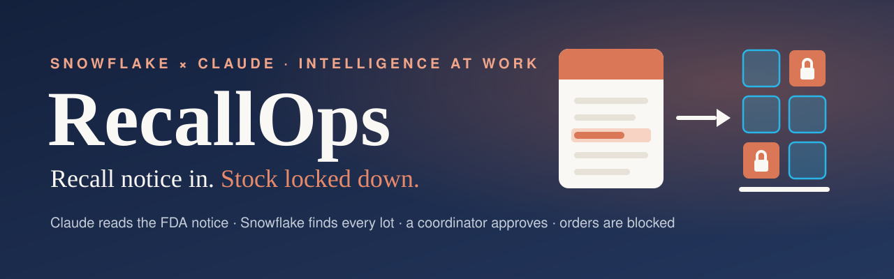
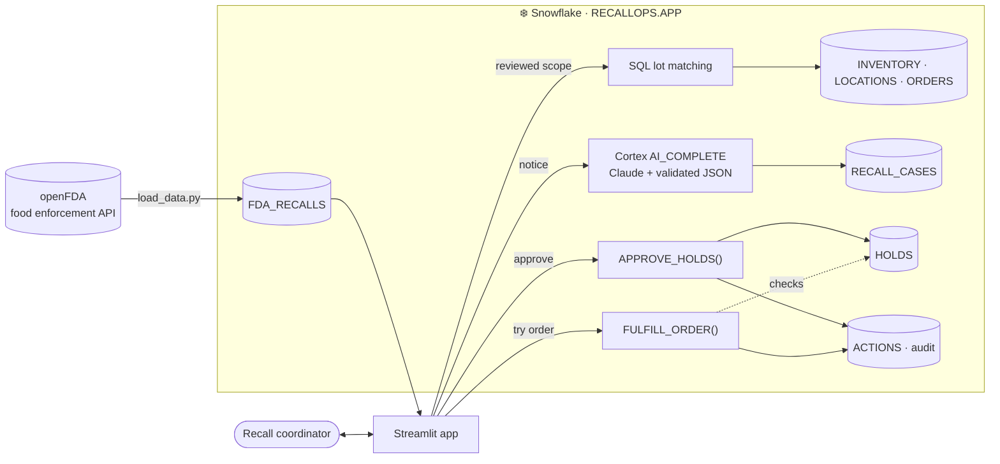

<p align="center">
  
</p>

<p align="center">
  
  
  
  
  
  
</p>

<h3 align="center">Turn a real FDA recall notice into reviewed, enforced inventory holds.<br>Claude reads the notice. Snowflake finds the stock. A person approves. Orders stop.</h3>

---

## The problem

When a supplier or the FDA recalls a food product, a grocery chain has to find every affected lot across its warehouse and stores, stop that stock from moving, and prove that it did. Notices are free text — UPCs, lot ranges, packaging variants, exceptions — and matching them to inventory is still done with spreadsheets, emails and phone calls to stores.

> In December 2025 the FDA reported recalled infant formula still available at **more than 175 retail locations across 36 states**, after over 4,000 checks. Its findings included confusion about affected product codes and incomplete removal. — [FDA](https://www.fda.gov/food/recalls-outbreaks-emergencies/fda-calls-food-industry-leaders-strengthen-recall-compliance-and-ensure-recall-effectiveness)

**RecallOps** is built for the person who has to fix that: the **recall coordinator** at a grocery chain or food distributor.

[Open the verified hosted app in Snowflake](https://app.snowflake.com/streamlit/sfsehol/anthropic_snowflake_hackathon_tadcdr/#/apps/RECALLOPS.APP.RECALLOPS_APP) (Snowflake sign-in required).

## How it works

| | Step | Who | What happens |
|:-:|---|---|---|
| 1 | **Read the notice** | Claude | `AI_COMPLETE` extracts UPCs, in-scope lot codes, evidence and ambiguities; the app validates the returned JSON |
| 2 | **Review the scope** | Coordinator | Evidence is highlighted in the notice; UPCs and lots can be edited before anything changes |
| 3 | **Match every lot** | Snowflake SQL | The reviewed scope is matched against lot-level inventory: **Affected**, **Outside scope** or **Needs review** (no lot on record — never silently treated as safe) |
| 4 | **Approve holds** | `APPROVE_HOLDS` | A stored procedure MERGEs holds (re-approval adds nothing) and writes the audit entry |
| 5 | **Block shipments** | `FULFILL_ORDER` | Every fulfilment checks for holds first — held stock is **BLOCKED**, other lots ship |

Claude proposes, SQL matches records, and a person approves holds. Claude never writes SQL; the notice is treated as data, not instructions. The demo uses the event account's `ATTENDEE_ROLE`; a separate approver role remains future work.

The current UI tabs are **1 The notice**, **2 Where it went**, **3 What we found**, **4 Lock it down** and **5 Audit trail**. The one-minute demo follows tabs 1 → 3 → 4 → 5. The graph rendered in the hosted app; the optional map still awaits visual inspection.

## Architecture



Notices, inventory, matching, holds and action history are stored or executed in Snowflake. The app invokes Claude through Cortex rather than a separate Anthropic API connection. Both the local and hosted Streamlit workflows have passed browser checks.

## Technology

| Layer | Used for |
|---|---|
| **Claude Opus 5.5** via **Snowflake Cortex `AI_COMPLETE`** | Structured extraction of recall scope with evidence and ambiguities |
| **Snowflake SQL** | Lot-level matching across inventory, locations and orders |
| **Snowflake stored procedures** (SQL Scripting) | Reviewed holds, repeat-approval protection and demo order enforcement |
| **Snowflake tables + VARIANT** | Notices, cases, model output, reviewed scope, holds, audit log |
| **Streamlit** (local or Streamlit in Snowflake) | The coordinator's workflow UI |
| **openFDA** `food/enforcement` | Real recall notices, firms, UPCs and lot codes |
| **Python** · `snowflake-connector-python` | Loader, verifier and app connection |

### Mapped to the hackathon's five dimensions

| Dimension | RecallOps |
|---|---|
| **Surface** | Streamlit workflow app (local, or hosted in Snowsight) |
| **Context** | Real FDA notices, lot-level inventory, orders, case history in Snowflake |
| **Toolkit** | Structured `AI_COMPLETE` call, SQL matching, constrained procedures |
| **Intelligence** | Claude interprets free-text scope, exceptions and ambiguity |
| **Action** | Approved holds written to Snowflake; held orders refused |
| *Cross-cutting* | Audit trail in `ACTIONS` · end-to-end verifier · human approval before holds are written |

## Data: what is real and what is generated

- **Real:** 1,999 unique FDA recall reports loaded into Snowflake from 2,000 fetched records; one record lacked a recall number and was skipped. The firms, descriptions, UPCs and recalled lot codes used in the demo come from these notices.
- **Generated:** the chain's stock quantities, six locations, pending orders and control lot strings. Each inventory product is a real recalled product with its real UPC and lot; control rows use lot strings outside that notice's scope, and some rows deliberately have no lot code to exercise **Needs review**. Outside-scope strings are not proof that a real lot is safe. A retailer would connect its own inventory and ordering tables.

## Verification status

| Check | Status |
|---|---|
| Snowflake connection (event account) | ✅ Verified |
| Setup SQL: database, tables, procedures | ✅ Created |
| Claude through `AI_COMPLETE` (`claude-opus-5-5`) | ✅ Full recall extraction in 12.1 s |
| openFDA load into Snowflake | ✅ 1,999 unique reports; 6 locations, 49 inventory rows, 10 orders |
| Extraction, approval, repeat approval, order decisions and audit | ✅ 15/15 live checks; case `VERIFY-873E22` |
| Local browser workflow | ✅ Case `CASE-DC8432B8`: 13.2 s extraction, 125 units / 2 stores, approved holds, blocked and fulfilled orders |
| Hosted Streamlit app | ✅ Streamlit 1.50 / warehouse runtime; case `CASE-C2E4E470`, 11.5 s extraction, 125 units / 2 stores, approval and order-button checks |
| Offline unit checks | ✅ 11 passed |

For recall `H-1339-2026`, the verifier created **2 holds for 125 units**, added **0** on repeat approval, left control lots unheld, blocked `O-101` and fulfilled `O-110`. It then removed its holds and restored those orders. [Full verification output](docs/verification-opus-5-5.txt).

Local browser evidence: [Claude notice and evidence](docs/assets/live-opus55-notice.png), [stock matching](docs/assets/live-opus55-stock.png), [holds and order decisions](docs/assets/live-opus55-orders.png).

Hosted evidence: [notice](docs/assets/hosted-opus55-notice.png), [stock](docs/assets/hosted-opus55-stock.png), [orders](docs/assets/hosted-opus55-orders.png), [SQL receipt](docs/hosted-verification.json). Hosted order buttons rechecked existing blocked/fulfilled states and wrote fresh action entries; the CLI verifier separately proved transitions from pending orders. Hosted person-level attribution is unverified because `CURRENT_USER()` returned `NULL`.

Opus 5.5 returned SQL `NULL` with native `response_format` in this account. The app retries with a JSON-only prompt and checks all required fields and types before accepting the scope. This fallback passed the live checks; native structured output is not claimed to work for this model.

No time savings or prevented harm are claimed; those need a measured manual baseline.

## Quick start

```bash
python3 -m venv .venv
.venv/bin/pip install snowflake-connector-python streamlit plotly requests python-dotenv graphviz
cp .env.example .env          # account, user, token, role, warehouse, model — never commit it

.venv/bin/python scripts/load_data.py                    # create RECALLOPS.APP and load real FDA data
.venv/bin/python scripts/verify.py --model claude-opus-5-5 --recall H-1339-2026  # live check
.venv/bin/streamlit run app/streamlit_app.py             # open http://localhost:8501
```

No local login? Paste `scripts/bootstrap_demo.sql` into a Snowsight worksheet: it creates the same objects with 12 selected real notices.

The event account is already loaded. Do not rerun the loader during the demo or while another agent uses the tables; it replaces demo data and history by default.

## Project structure

```
app/
  streamlit_app.py      coordinator workflow: notice → scope → match → approve → orders → audit
  recall.py             Claude prompt, JSON schema and AI_COMPLETE call
  db.py                 local connection or Streamlit-in-Snowflake session
sql/
  01_setup.sql          tables, APPROVE_HOLDS, FULFILL_ORDER
  02_streamlit_in_snowflake.sql   optional hosting in Snowsight
scripts/
  load_data.py          openFDA → Snowflake, plus inventory and orders built from recalled products
  verify.py             live end-to-end checks
  bootstrap_demo.sql    browser-only setup with 12 real notices
docs/assets/            banner and concept images
DEMO.md · SUBMISSION.md
```

## Built at the hackathon

Everything in this repository was built on **October 23, 2026** at the Snowflake × Anthropic *Intelligence at Work* hackathon: the schema and procedures, the openFDA loader, the Claude extraction prompt and schema, the Streamlit app and the verifier.

## Roadmap

- Supplier amendments with a side-by-side diff of notice versions
- Location confirmations ("Store 1 segregated 36 units") tracked against holds
- Ingest notices from email and PDF with `AI_PARSE_DOCUMENT`
- Separate approver role, enforced by Snowflake RBAC rather than the UI
- Pilot with one retailer on historical notices and approved inventory records
