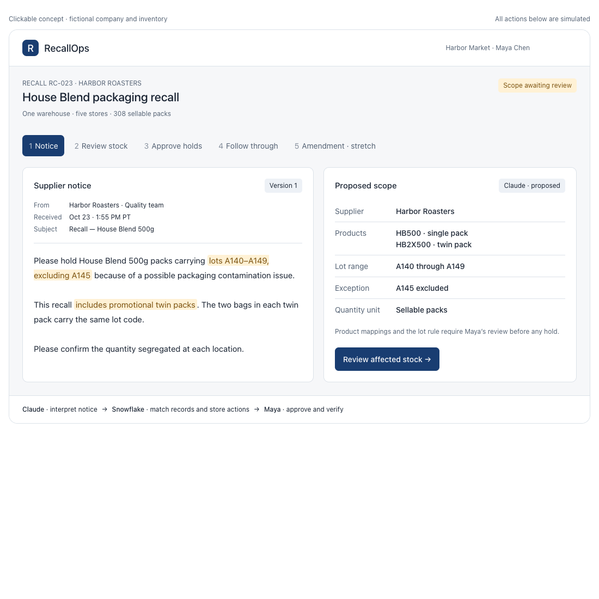
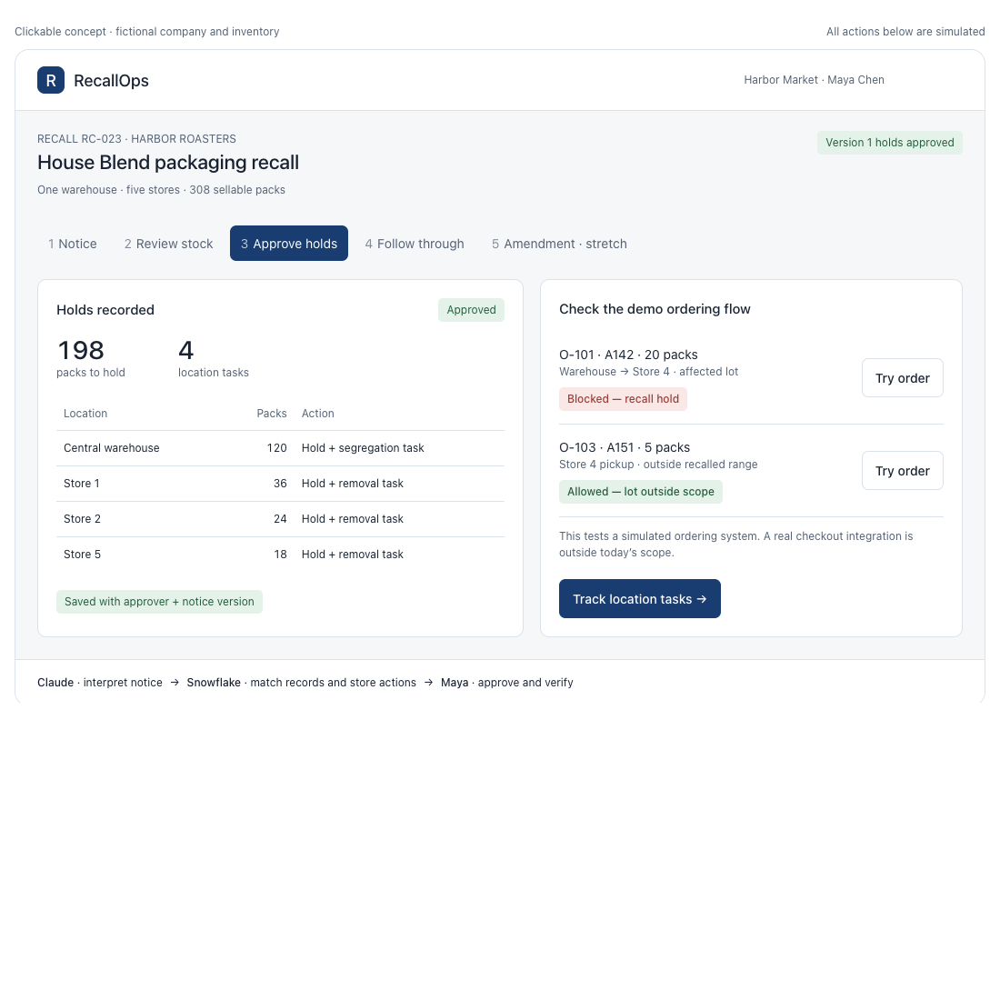
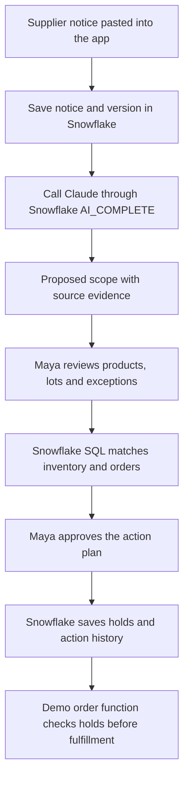
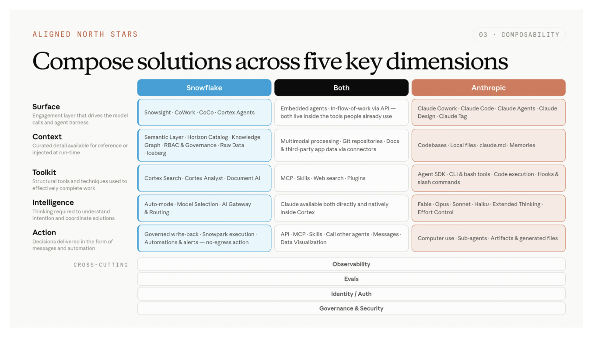

# RecallOps — Hackathon Brief

**Turn a supplier recall notice into reviewed inventory holds and location actions.**

- **Event:** Snowflake × Anthropic — Intelligence at Work Hackathon, October 23, 2026.
- **Business user:** Maya, the recall coordinator at a regional grocery chain.
- **Official build theme:** Internal — make the business run better.
- **Business domains:** Retail operations, inventory management, supply-chain traceability, and product-recall coordination.
- **Current status:** A clickable concept exists. The application, Snowflake connection, Claude integration, permissions, and live data actions have not been built or verified.
- **Data:** All company names, notices, stock quantities, orders, and people in the example are fictional.

## 1. The business problem

When a supplier recalls a product, a grocery chain must identify the affected stock across its warehouse and stores, stop further distribution, and confirm that locations have segregated it. Supplier notices can include product aliases, packaging differences, lot ranges, exceptions, and later amendments. These instructions must be connected to the chain's inventory and order records.

**Problem statement for the judges:**

> A recall notice tells a grocery chain which products are affected, but the chain still has to find the stock, stop it moving, and verify action at every location. RecallOps turns that notice into a reviewed, traceable operational response using Claude to interpret the instructions and Snowflake to determine and record exactly where action is needed.

There is documented evidence of failures in this process. On December 15, 2025, the FDA reported that recalled infant formula remained available at more than 175 retail locations across 36 states after over 4,000 checks. Its findings included uncertainty about affected product codes, incomplete removal, and continued stocking. These findings establish a consequential operational problem; they do not establish customer demand for RecallOps or prove that document interpretation caused every failure. [FDA findings](https://www.fda.gov/food/recalls-outbreaks-emergencies/fda-calls-food-industry-leaders-strengthen-recall-compliance-and-ensure-recall-effectiveness)

## 2. A realistic example

Maya works for **Harbor Market**, which has one warehouse and five stores. Supplier **Harbor Roasters** sends this notice:

> Please hold House Blend 500g packs carrying lots A140–A149, excluding A145, because of a possible packaging contamination issue. This recall includes promotional twin packs. The two bags in each twin pack carry the same lot code. Please confirm the quantity segregated at each location.

A **lot** is a production-batch identifier. All quantities below count **sellable packs**: a twin pack counts as one pack, even though it contains two bags.

| Location | Product | Lot | Packs | Initial decision |
|---|---|---|---:|---|
| Central warehouse | HB500 — 500g single pack | A142 | 120 | Affected |
| Central warehouse | HB2X500 — promotional twin pack | A145 | 40 | Explicitly excluded |
| Store 1 | HB500 | A143 | 36 | Affected |
| Store 2 | HB2X500 | A146 | 24 | Affected |
| Store 3 | HB500 | A145 | 30 | Explicitly excluded |
| Store 4 | HB500 | A151 | 28 | Outside the lot range |
| Store 5 | HB500 | A148 | 18 | Affected |
| Store 5 | HB2X500 | A145 | 12 | Explicitly excluded |

**Expected initial result:** 198 of 308 packs are affected, across four locations: the warehouse and Stores 1, 2, and 5. The other 110 packs are outside the initial scope.

Three pending orders test the response:

| Order | Stock source | Packs | Expected result after initial holds |
|---|---|---:|---|
| O-101 | Warehouse, HB500, A142 → Store 4 | 20 | Block |
| O-102 | Warehouse, HB2X500, A145 → Store 3 | 12 | Allow under this recall rule |
| O-103 | Store 4, HB500, A151 → customer pickup | 5 | Allow under this recall rule |

Order quantities are reserved from the inventory above. They are not added again to the affected-stock total. These allow decisions assume ordinary order checks also pass.

## 3. What Maya sees

### Stage 1 — Read the notice and proposed scope

The supplier text appears beside Claude's proposed interpretation: supplier, canonical products, packaging, lot range, excluded lots, and supporting text. Maya checks that the interpretation matches the notice.



### Stage 2 — Review the affected stock

The app shows each matching inventory record and why it was included or excluded. Maya sees the expected 198 packs across four locations and confirms the product mappings and exception before approval.

Unknown product names, missing lot data, or contradictory scope produce **Needs review**. No match does not establish that a product is safe or outside the recall.

### Stage 3 — Approve holds and test an order

Maya approves the reviewed plan. The backend saves holds against the affected inventory records and records the approval, notice version, and time. The demo ordering function then rejects O-101 and allows O-103.



These screenshots are simulated interface concepts. They do not prove that Snowflake has recorded a hold or that a real checkout system blocks sales.

### Stretch — Track confirmations and handle an amendment

If Store 1 confirms segregation of 36 packs and Store 2 confirms 24, the case shows **60 confirmed segregated and 138 awaiting confirmation**. A confirmation is a location's report, not independent verification of physical removal.

A supplier amendment then says:

> Lot A145 is now included. The A140–A149 range and product scope otherwise remain unchanged.

The amendment adds **82 packs**, giving **280 affected packs across five locations**. Only Store 3 is a newly affected location. O-102 must now be blocked after the additional holds are approved. Store 4's 28 packs of A151 remain outside the recall.

## 4. How Snowflake and Claude work together



The Python application coordinates this fixed workflow. The minimum build does not require an autonomous agent that chooses its own tools.

**Claude's job:** Interpret the human-written notice, identify exceptions and changes, propose product mappings, and expose uncertainty with supporting text.

**Snowflake's job:** Keep the business records and notice versions, join the reviewed scope to inventory and orders, calculate quantities, control access, and preserve approved actions.

The benefit of Snowflake is strongest when company operating data already lives there. This small fixture demonstrates that architecture; 308 packs alone do not require an enterprise data platform.

## 5. Exact Snowflake use in the minimum build

### A. Store the core data

Use a dedicated database/schema, for example `RECALLOPS.DEMO`, with five planned tables:

| Table | What it stores | Why it matters |
|---|---|---|
| `PRODUCTS` | Supplier, canonical SKU, product names/aliases, packaging, bags per pack | Connect notice terminology to known products |
| `INVENTORY` | Inventory record ID, SKU, location, lot code, quantity, approved hold reference | Establish where affected stock exists and its hold state |
| `ORDERS` | Order ID, inventory record ID, reserved quantity, destination, status | Test whether held stock can be fulfilled |
| `RECALL_CASES` | Original notice, version, model output, reviewed scope, case status | Preserve what was interpreted and approved |
| `ACTIONS` | Approval and hold events, actor, timestamp, notice version, optional location tasks | Make changes traceable and inspectable |

These are proposed objects, not existing tables. The fixture assumes reliable product and lot records, including the twin-pack mapping. Claude cannot reconstruct missing physical traceability.

### B. Run Claude through Snowflake

Use `AI_COMPLETE` with a Claude model available to the event account and a structured response schema. This means the model returns named fields rather than a free-form answer. Snowflake documents schema-constrained output for this function; the schema controls output shape, not factual correctness. [Structured outputs](https://docs.snowflake.com/en/sql-reference/functions/ai_complete-structured-outputs)

The requested fields would include:

```json
{
  "supplier_id": "HARBOR_ROASTERS",
  "proposed_product_ids": ["HB500", "HB2X500"],
  "lot_prefix": "A",
  "lot_start": 140,
  "lot_end": 149,
  "excluded_lots": ["A145"],
  "evidence": [
    "lots A140–A149, excluding A145",
    "includes promotional twin packs"
  ],
  "ambiguities": []
}
```

This is the expected fictional example, not an observed model response. Validate the fields, confirm evidence against the source text, and require Maya to approve the scope. Supplier text is input data; it cannot authorize actions or change application permissions.

### C. Match records and calculate in SQL

After review, use parameterized queries built by the application. The model supplies proposed values, not unrestricted executable SQL.

Illustrative matching logic for this reviewed fixture, **not yet executed**:

```sql
SELECT i.inventory_id, i.location, i.sku, i.lot_code, i.quantity
FROM RECALLOPS.DEMO.INVENTORY AS i
JOIN RECALLOPS.DEMO.PRODUCTS AS p ON p.sku = i.sku
WHERE p.supplier_id = 'HARBOR_ROASTERS'
  AND i.sku IN ('HB500', 'HB2X500')
  AND LEFT(i.lot_code, 1) = 'A'
  AND TRY_TO_NUMBER(SUBSTR(i.lot_code, 2)) BETWEEN 140 AND 149
  AND i.lot_code <> 'A145';
```

For this dataset, the expected quantity sum is 198 and the expected distinct-location count is four. Other lot-code formats require their own validated matching rules.

### D. Save an approved action

A narrow stored procedure—an operation implemented inside Snowflake—would validate the case/version and reviewed scope, apply the approved holds, and record action history together. Its execution rights must be deliberately configured. Snowflake supports procedures running with owner or caller rights. [Procedure rights](https://docs.snowflake.com/en/developer-guide/stored-procedure/stored-procedures-rights)

Repeated approval must not create duplicate holds/tasks in the tested sequence. Stronger concurrent-request guarantees remain unverified until specifically implemented and tested.

### E. Enforce the hold in the demo order flow

Every demo fulfillment attempt must query the current inventory hold. A held inventory record is rejected before the order can be marked fulfilled. This is the functional proof beyond simply displaying a red status label.

This enforcement applies to the demo ordering system. Real point-of-sale, warehouse, and ecommerce integrations are future work.

## 6. Mapping to the slide's five dimensions

The slide describes **architecture dimensions**, not five industry tracks. The event's stated build themes are **Internal** and **External**. RecallOps belongs primarily to **Internal**; its application domains are retail and supply-chain operations.



| Dimension | Plain meaning | RecallOps implementation | What we would demonstrate |
|---|---|---|---|
| **Surface** | Where the user works | A small Streamlit app hosted in Snowflake and opened through Snowsight | Maya moves from notice to stock review to approval |
| **Context** | The facts and rules available to the system | Snowflake tables containing product mappings, lot inventory, orders, notice versions, and approval state | Each affected quantity links to source records and the reviewed notice |
| **Toolkit** | The operations the application can perform | Structured model call, SQL matching/counting, and constrained approval/order functions | Inspect the match, save approved holds, and attempt an order |
| **Intelligence** | Interpretation of language and uncertainty | Claude through `AI_COMPLETE` interprets product scope, exceptions, and optional amendments | The A145 exception and promotional twin packs are handled correctly |
| **Action** | A decision changes business workflow state | Approved holds and action events saved in Snowflake; the demo ordering function checks those holds | O-101 is blocked while O-103 remains fulfillable |

Streamlit in Snowflake can host the interface and work with Snowflake data and procedures. Deployment permissions still need checking. [Streamlit in Snowflake](https://docs.snowflake.com/en/developer-guide/streamlit/about-streamlit)

The resource guide offers several ways to implement these layers. The minimum build uses Streamlit, Snowflake SQL, `AI_COMPLETE` with Claude, and controlled writes. Cortex Agents, Cortex Search, Cortex Analyst, Document AI, MCP, and CoCo remain optional tools for later scope; they are not implemented by this brief.

## 7. The four concerns across all five dimensions

| Concern | Planned proof |
|---|---|
| **Observability** — can we inspect what happened? | Store notice/model versions, proposed and reviewed scope, query IDs where available, approval events, elapsed times, and order-check outcomes |
| **Evals** — did it make the right decisions? | Compare actual matches with the manually labelled fixture; test range boundaries, the A145 exception, twin packs, missing identifiers, and blocked/allowed orders |
| **Identity / Auth** — who can do what? | Use authenticated Snowflake access and narrowly granted operations; verify approval authorization with an actual denied/allowed backend call |
| **Governance & Security** — how are data and actions controlled? | Synthetic data, restricted table access, reviewed scope, validated inputs, parameterized queries, versioned approvals, and recorded changes |

**Streamlit permission detail:** By default, Streamlit in Snowflake runs with the app owner's privileges. A role selector or hidden approval button does not prove that a viewer lacks backend authority. The approval surface must be restricted appropriately, and the underlying database permission behavior tested separately. [Streamlit owner rights](https://docs.snowflake.com/en/developer-guide/streamlit/object-management/owners-rights)

Model availability, region settings, and access grants must be verified in the supplied account. This brief does not claim a particular inference region, no data egress, or production security readiness.

## 8. What can be built before 4:30 PM PT

**Planning snapshot: approximately 3:26 PM PT. No implementation has started.** This is an aggressive target conditional on starting around 3:30 and getting account/model access working promptly.

| Time, PT | Target | Completion evidence |
|---|---|---|
| 3:30–3:40 | Verify access and load the small fixture | Successful Snowflake query and real Claude response |
| 3:40–4:00 | Paste notice, extract scope, review and match inventory | Live response plus expected 198-pack/four-location result |
| 4:00–4:12 | Save approved holds and enforce the order check | Persistent rows; affected order rejected |
| 4:12–4:20 | Verify core cases | Excluded and outside-range stock remain available; repeated approval creates no duplicate actions in the tested sequence |
| 4:20–4:25 | Record the one-minute demo and check the public repository | Accessible video/repository and clear original-work description |
| 4:25–4:30 | Submit and verify | Actual submission confirmation |

**Core:** one page with notice, scope review, matching stock, approved holds, and blocked/allowed order tests. Use pasted text and synthetic records.

**Stretch:** location confirmations and an amended recall. Add them only after the complete core workflow passes. Real email ingestion, PDF parsing, checkout integrations, and automatic customer communications are outside this build window.

If Snowflake/Claude access fails, the visual concept remains useful for explanation but does not establish the required working integration. Do not present a mock response as a real model call or a local browser state change as a Snowflake write.

## 9. Demo acceptance criteria and measured impact

All cases below are **planned / not run** against the real implementation.

| Test | Expected result |
|---|---|
| Initial notice | Match exactly 198 packs across four locations |
| A145 exception | Exclude all 82 A145 packs initially |
| Outside-range control | Keep the 28 A151 packs outside the recall |
| Packaging scope | Include the 24 A146 promotional twin packs |
| Approval | Persist holds with reviewer and notice version |
| Affected order O-101 | Reject fulfillment of its 20 held packs |
| Unaffected order O-103 | Allow its five packs, assuming ordinary checks pass |
| Repeated approval | No extra holds/tasks in the tested sequence |
| Missing/ambiguous product or lot | Require investigation; do not silently mark it safe |
| Amendment — stretch | Add 82 packs, reach 280 affected packs, and block O-102 after approval |

Measure elapsed time from notice submission to approved holds, correctly matched affected records, incorrectly held unaffected records, and order-check outcomes. Claim time savings only after timing a comparable manual baseline. Location confirmations are self-reported. Do not claim prevented illness, physical stock removal, or financial savings from this synthetic demo.

## 10. One-minute demo and hackathon fit

- **0–10 seconds:** Introduce Maya and the recall notice with a lot exception and promotional packaging.
- **10–25 seconds:** Show the real Claude response and human scope review.
- **25–40 seconds:** Show Snowflake matching 198 packs across four locations; approve holds.
- **40–55 seconds:** Attempt O-101 and O-103; show one rejected and one allowed, then inspect the recorded approval.
- **55–60 seconds:** State the measured results and accurately identify simulated integrations.

The contribution is a complete operational workflow: language interpretation, business-record matching, human approval, persistent action, and enforced order behavior. The main feature is completing the recall response, rather than viewing a dashboard or asking document questions.

According to the supplied participant guide:

- Core data must live in Snowflake, and governance must be visible.
- Synthetic data is allowed; use data and assets the team has rights to.
- Repositories must be public; maximum team size is three.
- Demonstrate and identify the specific functionality built during the event.
- Submit an accessible one-minute video by **4:30 PM PT on October 23, 2026**.
- Round-one weights: impact 35%, demo 30%, creativity 25%, Snowflake/Claude craft 10%. Final-round categories have equal weight.

These are submission requirements, not evidence that submission or implementation has happened.

## Sources and status

- Event rules and scoring: the participant guide supplied in this conversation.
- Architecture framework: the supplied five-dimension slide and technical-resources guide.
- External evidence and platform references are linked beside their claims above.
- Concept images are simulated screenshots from the walkthrough created for this discussion.
- **Verified so far:** document review, the fixture arithmetic, and clickable-concept interactions/layout.
- **Unverified:** account access, live Claude output, Snowflake tables/procedures, backend permissions, persisted holds, functional order enforcement, deployment, and submission.
